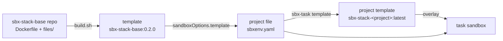

# sbx-stack base image: the owner's setup as a template, built from a Dockerfile

Status: design, written 2026-11-10. Not built yet. It changes the base layer of
[the sbx-stack design](2026-11-04-sbx-stack-design.md) (from here on "the stack spec"). Everything else in the
stack spec stays.

## 1. Intent

The base layer of sbx-stack is the owner's personal setup: shell, CLI tools, editor, git setup and the Claude setup.
Today it is the kit `sbx-kit-base`. Its install hooks run apt, git clones and plugin installs in every new sandbox,
and its descriptor is a long YAML file with shell scripts inside.

The owner wants:

1. **The personal setup in one image**, built from a Dockerfile, versioned, and used as the template of every
   project. Plugin updates and tool updates need a rebuild; that is accepted (owner, 2026-11-10).
2. **Project files that hold only project things.** A project file names the base image and its own layers. No
   personal setup is declared in it.
3. **The repo is the source of truth.** The image gets nothing from the Mac at build time. The Mac's chezmoi
   dotfiles (`~/.local/share/chezmoi`) are a one-time seed: copied once, stripped, reviewed and committed. After
   that the two drift apart on purpose. No sync or mirror script.

## 2. Goals, non-goals, anti-goals

### Goals

1. `build.sh <version>` in the new repo `sbx-stack-base` builds the image and loads it into sbx as the template
   `sbx-stack-base:<version>`.
2. A sandbox from that template has the full personal setup at once. No install work for the base runs at create.
3. Every dependency is pinned or listed in the repo (section 6).
4. `tests/check.sh` proves the setup in a real sandbox.
5. The rest of sbx-stack (`sbx-task`, the example project, the kit-builder skill, the docs) uses the image instead
   of the base kit.

### Non-goals (for now)

- **Language stacks in the image** (node, ts, python, go). They stay layer kits in the project file. Adding the
  most common ones to the image is a later decision (owner, 2026-11-10).
- **A registry.** The image is built and loaded on each Mac. Pushing to a registry comes later.
- **Opening tasks in a new Ghostty window** from `sbx-task run`. That is a Mac-side change for later.
- **Automatic updates.** No job checks for new tool, plugin or Claude versions.

### Anti-goals (failure even if it works)

- **Anything from the Mac at build time**: no copy from `~/.claude`, `~/.config` or chezmoi in `build.sh` or the
  Dockerfile. The one exception is the git identity: `build.sh` reads `user.name` and `user.email` from the Mac's
  global git config (section 5.4), and nothing else.
- **A secret in the image.** The image is a file that can be copied. No token, key or credential goes in, also
  not from the build machine.
- **The owner's name in a committed file** (the owner's standing rule). The git identity is a build input read
  from the Mac's global git config (section 5.4).
- **Downloads at sandbox start.** Mason, lazy.nvim, oh-my-zsh updates and similar must not try the network when a
  sandbox starts. The runtime network rules do not allow GitHub, so a try only makes errors and blocked requests.

## 3. Constraints

| Constraint | Source |
|---|---|
| macOS on Apple silicon, Docker Desktop (29.x) for `docker build`, sbx v0.51.0 | the owner's Macs |
| The image is `FROM docker.io/docker/sbx-kit-claude:<version>@sha256:<digest>`. A project file that uses the image lists the same Claude kit version in `kits` | F11, section 4 |
| Bash scripts: `#!/usr/bin/env bash`, `set -euo pipefail`, shellcheck clean, bash 3.2 compatible | owner's style |
| Build for `linux/arm64`. Other platforms are not needed | the owner's Macs |
| Ask before creating a GitHub repo or pushing | owner's standing rule |

## 4. Facts this design rests on

Checked on 2026-11-10 with sbx v0.51.0. F11 has a probe in `sbx-kit-builder/tests/facts/f11-image/`
(`tests/facts/run.sh f11`).

| Fact | Consequence |
|---|---|
| **F11.** `docker.io/docker/sbx-kit-claude:2.1.314` is a normal multi-arch image (user `agent`, uid 1000, entrypoint `claude --dangerously-skip-permissions`, workdir `/home/agent/workspace`). An image built `FROM` it, saved with `docker image save` and loaded with `sbx template load` (2 s), works as `sandboxOptions.template` with `pullPolicy: never`. The create took 4 s | The Dockerfile route works |
| F11: files in `/etc` and under `/home/agent` (including folders under `~/.claude`) stay as the image has them | Tools, configs, plugins and LazyVim plugins can live in the image |
| F11: sbx writes `~/.claude/settings.json` new at create (with its own hooks and statusline). The image's copy is lost | The Claude settings cannot go in `~/.claude/settings.json` |
| F11: `/etc/claude-code/managed-settings.json` from the image stays. The Claude kit image has no `/etc/claude-code` | Managed settings are the place for the owner's Claude settings |
| Claude Code docs: managed settings on Linux are `/etc/claude-code/managed-settings.json`. Nothing in user settings overrides a managed key. Hooks merge across levels, so the sbx hooks and the managed hooks both run. The file alone changes nothing else; an unparseable file stops Claude from starting | No settings merge at boot is needed. `check.sh` must prove the file parses |
| sbx docs: "Agent configuration files are always recreated when a sandbox is created" (`settings.json`, `.claude.json`) | Same as F11 |
| sbx writes `~/.claude/.credentials.json` at create | It is not in the Docker-built image. See open point 2 for snapshots |
| Debian trixie has `direnv` (2.32), Neovim 0.10.4, Python 3.14 in the image. It has no `yazi` and no worktrunk | yazi, worktrunk and Neovim come as pinned release binaries |
| Debian's `ncurses-term` has the terminfo entry `ghostty`, not `xterm-ghostty`, and the image does not install it | No terminfo work: see F12 |
| F10: a template keeps the whole VM disk; kit install hooks run again in a sandbox from it | Project kits (node, ...) still run their install hooks, as today |

| **F12.** sbx does not pass the Mac's `TERM`. With `TERM=xterm-ghostty` on the Mac, `sbx exec -it` gives `TERM=xterm-256color`, and `sbx exec` without a TTY gives no `TERM` | Ghostty works through `xterm-256color` already. An `xterm-ghostty` entry in the image is never used unless the image sets `TERM` itself |
| **F13.** `~/.claude/.credentials.json`, written by sbx at create, holds placeholders: `accessToken` and `refreshToken` are 26 characters each and match a placeholder pattern (a real OAuth token is far longer). The `mcp-gateway` `Authorization` header in `~/.claude.json` is a 20-character placeholder too. The other `.claude.json` values are flags, ids and timestamps | A snapshot from `sbx-task template` stores no real Claude token. `sbx-task` needs no change for this. The proxy swaps the real token on the Mac side |

The probes F12 and F13 print key names, types, lengths and shape tests only, never a value
(`tests/facts/run.sh f12 f13`).

## 5. The design

### 5.1 Approaches

| Approach | What it does | Trade-off | Picked |
|---|---|---|---|
| **A Dockerfile build** | `docker build` from a Dockerfile and `files/`, then `docker image save` and `sbx template load` | The file is the whole recipe: builds repeat, diffs are easy to read. No VM and no sbx network rules in the build. Needs Docker on the Mac | **yes** (owner, 2026-11-10) |
| A script in a fresh sandbox, then `sbx template save` | The owner's first sketch: start an empty sandbox, run the installs, snapshot | Works today, but the recipe is a script plus a VM state, so rebuilds drift. The sandbox needs install network rules. A snapshot may hold the sandbox's `.credentials.json` | no |
| Keep the kit, move the inline YAML into scripts | `base.yaml` calls `files/install.sh` | Smallest change, but every sandbox still installs everything. Misses the goal | no |

### 5.2 The shape



1. `sbx-stack-base` builds the base template.
2. A project file names it: `sandboxOptions.template: sbx-stack-base:<version>` and `pullPolicy: never`.
3. `sbx-task template <project>` saves a task of that project as `sbx-stack-<project>:latest`, as today. Its
   overlay sets `sandboxOptions.template` again, and the later file wins (F3). So a project template sits on top
   of the base image, and holds the project's kit installs.

### 5.3 The repo

`sbx-kit-base` becomes `sbx-stack-base`: same git history, folder renamed to `~/workspace/docker-sbx/sbx-stack-base`.
It is no longer a kit, so it leaves the `sbx-kit-<layer>` naming. Not pushed yet.

```text
sbx-stack-base/
├── Dockerfile             # FROM the Claude kit by tag + digest; every pinned version as an ARG on top
├── VERSION                # the image version, for example 0.2.0
├── apt-packages.txt       # one Debian package per line
├── build.sh               # docker build, docker image save, sbx template load
├── files/
│   ├── zsh/zshrc
│   ├── starship.toml
│   ├── git/aliases.gitconfig
│   ├── nvim/              # the LazyVim config, with lazy-lock.json and lazyvim.json
│   └── claude/            # managed-settings.json, statusline, statusline.sh, hooks/
├── tests/
│   ├── sbxenv.yaml        # agent + Claude kit + the template; no secrets, no host commands, skills "off"
│   └── check.sh
└── README.md
```

Deleted from the old repo: `base.yaml`, `base.dockerfile`, `host/sync-from-mac.sh` (it copies from the Mac, which
the anti-goals forbid), and `tests/sbxenv-nomkt.yaml` (it tested the kit's marketplace arg).

### 5.4 What the image holds

| Part | Content | Where in the image |
|---|---|---|
| CLI tools (apt) | zsh, eza, zoxide, starship, btop, fzf, ripgrep, fd-find, bat, shfmt, gitleaks, direnv; `bat` and `fd` under their usual names | `/usr/bin`, links in `/usr/local/bin` |
| CLI tools (release binaries) | Neovim (0.11.2 or newer, for LazyVim), yazi, worktrunk (`wt`) | `/usr/local/bin` (Neovim under `/opt/nvim`) |
| zsh | the login shell of `agent`; oh-my-zsh with fast-syntax-highlighting and fzf-tab at pinned commits; `files/zsh/zshrc` sourced from `/etc/zsh/zshrc`; an empty `~/.zshrc` so zsh skips its first-run wizard | `/usr/local/share/sbx-stack/` |
| zshrc additions | `direnv hook zsh`; `wt config shell init zsh`; yazi's `y` function and `rr` alias | `files/zsh/zshrc` |
| Ghostty support | `COLORTERM=truecolor` in the zshrc; `TERM` stays `xterm-256color`, which sbx sets (F12) | `files/zsh/zshrc` |
| git | the aliases include in the system config; `user.name` and `user.email` from the build inputs `GIT_USER_NAME` and `GIT_USER_EMAIL`, unset if empty | `/etc/gitconfig` |
| Neovim | the LazyVim config; lazy.nvim plugins restored from `lazy-lock.json`; treesitter parsers for the kept languages compiled at build | `~/.config/nvim`, `~/.local/share/nvim` |
| Claude settings | output style, `tui`, statusline, the safety hooks, `enabledPlugins` | `/etc/claude-code/managed-settings.json` |
| Claude files | the statusline scripts and the hook scripts | `/usr/local/share/sbx-stack/claude/` |
| Claude plugins | the marketplaces and the ever-green plugins of today's base kit (`adhd-friendly-simple-technical-english`, `quota-statusline`, `hookify`, `superpowers`), installed at build with `claude plugin` as `agent` and enabled in the managed settings | `~/.claude/plugins` |
The git identity: `build.sh` reads `git config --global --get user.name` and `user.email` on the Mac and passes
them as the build args `GIT_USER_NAME` and `GIT_USER_EMAIL`. An empty value leaves that key unset in the image.
No other git key is read: `user.signingkey`, `includeIf` and the rest stay on the Mac. The values show in
`docker history` of the local image; they are not secret. This keeps the owner's name out of the repo with no
second file to maintain (owner, 2026-11-10).

A project with another identity (the owner's work projects use `includeIf` rules on the Mac, which the sandbox
does not see) sets it in its project file `env`: `GIT_AUTHOR_NAME`, `GIT_AUTHOR_EMAIL`, `GIT_COMMITTER_NAME`,
`GIT_COMMITTER_EMAIL`. git reads these variables before any config file.

### 5.5 The one-time seed

The seed is one commit that the owner reviews. Its sources:

| Repo file | Seed source | Change |
|---|---|---|
| `files/zsh/zshrc` | today's `sbx-kit-base/files/zsh/zshrc` (already a stripped copy of chezmoi's `dot_zshrc.tmpl`) | add direnv, worktrunk and yazi; `EDITOR=nvim`; `vim` and `lazyvim` start nvim; paths for the new image layout |
| `files/starship.toml`, `files/git/`, `files/claude/` | today's `sbx-kit-base/files/` | `settings.json` becomes `managed-settings.json`; the paths stay under `/usr/local/share/sbx-stack` |
| `files/nvim/` | chezmoi's `home/dot_config/nvim-lazyvim/` | the cut below |
| `files/yazi/` | chezmoi's `home/dot_config/yazi/` (yazi.toml, theme.toml, package.toml, the flavors) | drop Mac-only openers and paths; goes to `~/.config/yazi` |

The LazyVim cut:

| Group | Items | Why |
|---|---|---|
| **Keep** | plugin files: blink-cmp, claudecode, colorscheme, conform, diffview, dropbar, `extend-*` (except markdown-preview), git-conflict, gitsigns-blame, hardtime, harpoon, lualine, neo-tree-git, neovim-tips (with `neovim_tips/user_tips.md`), overseer, rip-substitute, text-case, tiny-inline-diagnostics, trouble. Extras: `ai.claudecode`, `coding.*`, `editor.*`, `ui.*`, `util.*`, `lang.git` | They need no Mac, no secret and no language runtime |
| **Drop** | chezmoi, herdr-splits, vim-tmux-navigator, wishes (a local checkout), example, extend-markdown-preview (opens a Mac browser), minuet (AI completion with an API key), gitlab (a GitLab token) | They need the Mac, a secret or a host program |
| **Later, with the stack layers** | extras `lang.typescript`, `lang.typescript.oxc`, `linting.eslint`, `formatting.prettier`, `lang.astro`, `lang.prisma`, `lang.tailwind`, `lang.python`, `lang.go`, `lang.sql`, `lang.helm`, `lang.json`, `lang.yaml`, `lang.markdown`, `lang.docker`, `lang.toml`, `dap.core`, `test.core`; plugin files dap-js, vitest | Their language servers and tools need node, python or go, or come from Mason at runtime |

Mason: no install at sandbox start. No language server is in the base image. The stack layers bring theirs later.

### 5.6 Versions and updates

| Dependency | Pin in the repo | How to update |
|---|---|---|
| Claude Code and the OS | `FROM ...sbx-kit-claude:<version>@sha256:<digest>` | change both, rebuild, bump `VERSION`, change the Claude kit version in project files |
| apt packages | names in `apt-packages.txt`; versions float at each build | rebuild |
| Neovim, yazi, worktrunk | version + sha256 of the release file, as Dockerfile ARGs | change the ARGs, rebuild |
| oh-my-zsh and its two plugins | commit sha | change the sha, rebuild |
| LazyVim plugins | `files/nvim/lazy-lock.json` | update in a sandbox (`:Lazy update` needs GitHub, so on the Mac or in a build), commit the lock, rebuild |
| Claude plugins | none: the build installs the newest version; `build.sh` prints the version and commit of each plugin | rebuild (owner, 2026-11-10: frozen until a rebuild; still no pin after a security review flagged it) |

The image tag is `sbx-stack-base:<VERSION>`. `build.sh` also adds the image labels
`org.opencontainers.image.revision` (the repo commit) and `sbx-stack.claude-kit` (the Claude kit version).

### 5.7 How a project uses it

```yaml
schemaVersion: "1"
agent: sbx-kit-claude
kits:
  - docker.io/docker/sbx-kit-claude:2.1.314   # the same version as the image's FROM
  # project layers, for example node, come here later
workspace: ./workspace
sandboxOptions:
  template: sbx-stack-base:0.2.0
  pullPolicy: never
  skills: "off"
```

The base kit and its args (`gitUserName`, `gitUserEmail`, `plugins`, `marketplaces`) leave the project file.

### 5.8 Plugins that need a layer

A project plugin is a Claude plugin that only some projects need. Most of them need a layer: the gitlab plugin
needs the gitlab layer's token swap and network rules, playwright needs a node and browser layer, and CodeScene
needs a token and the CodeScene API (owner, 2026-11-10).

1. **A plugin with a layer comes with that layer.** The layer kit installs the plugin in its install hook, owns
   the plugin's network rules and credential placeholder, and enables the plugin. A project picks the layer and
   gets the plugin with it. This replaces the base kit's `plugins` arg (stack spec decision 8).
2. **A plugin without a layer goes into the base image** and is enabled in the managed settings.
3. **CodeScene is a layer** (owner, 2026-11-10): the kit `sbx-kit-codescene` (Plan 2) installs the plugin
   `codescene@codescene` and its MCP server `@codescene/codehealth-mcp` (so the server's `npx -y` start needs no
   npm download), owns the network rule for the CodeScene API and the token placeholder, and enables the plugin.
   The project file's `secrets` gives the token source. Nothing of CodeScene is in the base image: it cannot work
   without the kit, and an enable in the managed settings could not be turned off per project.

How a layer kit enables a plugin: the managed settings do not set its key in `enabledPlugins`, so the kit's
startup hook may set it in `~/.claude/settings.json`, which sbx writes new at each create. Plan 2 probes the order
of sbx's settings write and the kit startup hooks before it relies on this.

### 5.9 Tests

`tests/check.sh` loads nothing itself: it needs the template from `build.sh`. It creates `check-base` from
`tests/sbxenv.yaml`, asserts with `sbx exec`, and removes the sandbox, also on failure. It carries over the old
check's assertions that still apply, and adds:

1. Every tool runs: `nvim --version` (0.11.2 or newer), `yazi --version`, `wt --version`, `direnv version`, and the
   apt tools.
2. `echo $COLORTERM` in a login shell prints `truecolor`.
3. `managed-settings.json` parses as a JSON object, and `claude` starts (`claude --version`).
4. The ever-green plugins are installed and enabled (`claude plugin list`).
5. `nvim --headless "+qa"` exits 0 with no error output, and the sandbox's network log
   (`sbx policy log check-base`) shows no blocked request from Neovim or Mason.
6. zsh is the login shell, the zshrc loads with no error, and `wt` and `direnv` hooks are defined.
7. git: the aliases work; `user.name` and `user.email` match the build args.
8. After stop and start, all of the above still hold.

`build.sh` prints the image size. The README records the size and the create time of `check-base`.

## 6. Changes to sbx-kit-builder

| File | Change |
|---|---|
| `examples/hello/sbxenv.yaml` | drop the base kit; add the template lines of section 5.7 |
| `tests/e2e.sh` | needs the base template; fails early with a clear message if `sbx template ls` lacks it. `SBX_KIT_BASE` goes |
| `bin/sbx-task` | no change needed: the overlay already sets `sandboxOptions.template` and wins (F3). Builder checks this in e2e |
| `skills/kit-builder/` | the base is now an image: what goes in the image (personal setup) and what goes in a kit (project layers) |
| `docs/facts.md` | add F11 and F12 |
| the stack spec | the base kit rows (5.1, 5.4, 5.5, decisions 5, 8 and 14, designer's call 6) point to this design |
| `README.md` | the repo table names `sbx-stack-base` |

The getting-started page (the private artifact "sbx-stack Getting Started") is updated after the build.

## 7. Decisions made

| # | Decision | Who, when |
|---|---|---|
| 1 | The base layer is an image, not a kit | owner, 2026-11-10 |
| 2 | Only the personal setup goes in the image; language stacks stay kits for now | owner, 2026-11-10 |
| 3 | Built from a Dockerfile, with the probes first (F11 passed) | owner, 2026-11-10 |
| 4 | Plugin and tool updates need a rebuild | owner, 2026-11-10 |
| 5 | The repo is the source of truth; chezmoi is a one-time seed of a stripped zshrc and the LazyVim config | owner, 2026-11-10 |
| 6 | Add yazi, direnv and worktrunk; skip git-machete and tmux | owner, 2026-11-10 |
| 7 | Ghostty: Ghostty works through `TERM=xterm-256color`; a Ghostty window from `sbx-task` is later | designer's call, 2026-11-10 |
| 8 | The git identity comes from the Mac's global git config (`user.name`, `user.email` only), not from a separate local file | owner, 2026-11-10 |
| 9 | Plugins that need a layer come with that layer; plugins without a layer go into the base image | owner, 2026-11-10 |
| 10 | CodeScene is entirely a layer kit (`sbx-kit-codescene`, Plan 2): plugin, MCP server, network rule, token placeholder and enabling | owner, 2026-11-10 |
| 11 | No `xterm-ghostty` terminfo: sbx sets `TERM=xterm-256color` (F12). The zshrc sets `COLORTERM=truecolor` | designer's call, 2026-11-10 |

## 8. Designer's calls

Each can be overruled.

| # | Call | Why |
|---|---|---|
| 1 | Repo name `sbx-stack-base`, history kept | It is no longer a kit; the history explains the files |
| 2 | Claude settings as managed settings, no boot merge | F11; hooks merge, so the sbx hooks stay. Cost: a change of a managed key inside a sandbox (for example the output style) has no effect |
| 3 | apt versions float | Security fixes come with each rebuild. Pinning a Debian snapshot date is possible but needs a manual date bump |
| 4 | No language servers and no Mason in the base | They belong to the stacks; Mason needs the network at runtime |
| 5 | A project with another git identity sets the `GIT_AUTHOR_*` and `GIT_COMMITTER_*` variables in its project file `env` | The Mac's `includeIf` rules do not reach the sandbox; env variables beat every git config file |
| 6 | Local build and load only | One Mac at a time; a registry adds auth and a public image for no gain yet |
| 7 | The LazyVim config goes to `~/.config/nvim`, plain `nvim` | One config in the image; `NVIM_APPNAME` is a Mac detail |
| 8 | The yazi config is part of the seed | yazi is in the image; without its config it ships with defaults until a second seed commit |
| 9 | The apt archive network rule (`deb.debian.org`, `dhi.io`), which the base kit owned, is not moved now. Plan 2 decides it with the first layer kit that needs apt. The kit-builder skill says that sbx refuses the same rule in two kits, so only one kit may own it | No layer kit needs apt in this work. The answer depends on what node and the other stacks need, so deciding it now is a guess |

## 9. Open points for the owner

1. ~~Project plugins lose their home.~~ Closed: plugins come with their layer (section 5.8).
2. ~~A snapshot may store the sandbox's credentials file.~~ Closed by F13: the file holds placeholders only.

## 10. Left to the builder

- How to compile the treesitter parsers in the build (build tools in a separate stage or removed after).
- How to install plugins and LazyVim plugins at build time without a TTY, and how to make `check.sh` prove it.
- The exact release file names and checksums of Neovim, yazi and worktrunk for `linux/arm64`.
- How `build.sh` handles a rebuild of the same version (refuse, or replace with `--force`).
- The order of the work, as long as the seed commit comes first and stays reviewable on its own.
